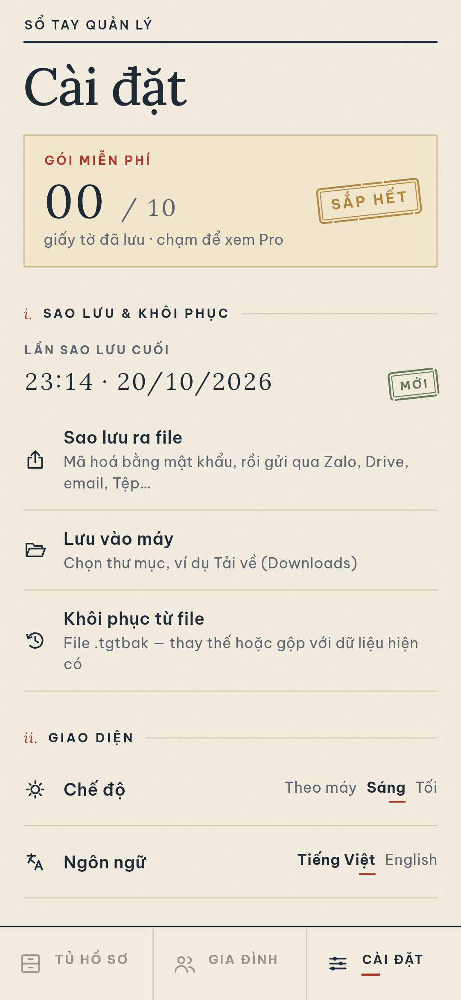
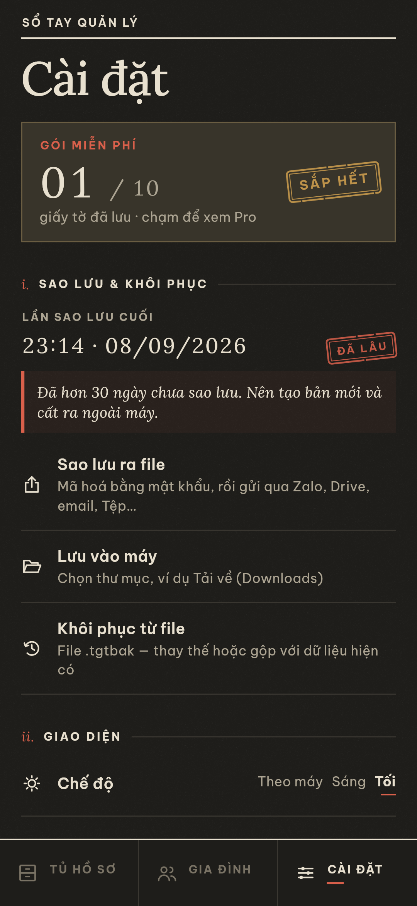

# Tủ Giấy Tờ

**Két giấy tờ gia đình & nhắc hạn — mã hoá trên máy, không cần tài khoản.** · Phiên bản 0.3.0

Tủ Giấy Tờ giúp bạn cất giữ CCCD, bằng lái, cà-vẹt, đăng kiểm, bảo hiểm xe, hộ chiếu, thẻ BHYT, phiếu bảo hành… của cả nhà trong một "cuốn sổ" duy nhất. Giao diện theo phong cách "hồ sơ lưu trữ": giấy ngà có vân, mực xanh than, dấu son; mỗi giấy tờ là một bìa hồ sơ manila có nhãn và số hồ sơ, tình trạng hạn được đóng dấu "Còn hạn / Sắp hết / Quá hạn". Ứng dụng tự đọc số và ngày hết hạn bằng OCR ngay trên điện thoại, rồi nhắc bạn trước khi giấy tờ hết hạn.

> Ứng dụng Flutter cho **Android và iOS**. Giao diện tiếng Việt (có bản dịch tiếng Anh).

## Ảnh màn hình

Ảnh dùng **dữ liệu MẪU hư cấu** (gắn nhãn "MẪU"), được render bằng Flutter golden test (`test/screenshots_test.dart`) từ chính các widget của ứng dụng.

| | | |
|:-:|:-:|:-:|
| <br>Trang chủ – Sắp đến hạn | <br>Chế độ tối | <br>Chi tiết giấy tờ |
| <br>Thêm giấy tờ + nhận dạng | <br>Xuất trình nhanh | <br>Hồ sơ gia đình |
| <br>Hồ sơ tài sản (ô tô) | <br>Hướng dẫn gia hạn | <br>Cài đặt |
| <br>Pro (cờ thử nghiệm) | <br>Trình xem ảnh/PDF | <br>Khoá sinh trắc học |
| <br>Hộ chiếu (tối) | <br>Sao lưu & khôi phục | <br>Nhắc sao lưu sau 30 ngày (tối) |

## Tính năng

- **Thêm giấy tờ** bằng camera, ảnh trong thư viện hoặc file PDF. Mỗi giấy tờ có thể chứa nhiều tệp: mặt trước, mặt sau, các PDF.
- **Nhận PDF/ảnh chia sẻ từ ứng dụng khác**: Android hỗ trợ `ACTION_SEND`/`SEND_MULTIPLE`/`VIEW` cho PDF và ảnh.
- **Trình xem** ảnh (phóng to) và PDF nhiều trang. **Gộp nhiều ảnh thành 1 PDF** để chia sẻ.
- **OCR trên máy** (Google ML Kit Text Recognition) cho ảnh, và cho PDF bằng cách render trang thành ảnh rồi OCR. Ứng dụng tự nhận ra **CCCD, bằng lái, cà-vẹt, đăng kiểm, bảo hiểm xe, hộ chiếu (đọc MRZ), phiếu bảo hành, BHYT**, rồi điền sẵn số, họ tên và ngày hết hạn. Người dùng luôn xác nhận hoặc sửa trước khi lưu.
- **Hồ sơ** cho từng thành viên và tài sản (ô tô, xe máy, nhà, thiết bị).
- **Nhắc hạn bằng thông báo cục bộ**, có mốc mặc định theo loại: đăng kiểm, bảo hiểm và bảo hành nhắc trước 30/7 ngày; hộ chiếu trước 6 tháng (180/30 ngày); CCCD tự tính hạn theo **mốc tuổi 14 – 25 – 40 – 60** từ ngày sinh và ngày cấp. Mỗi giấy tờ có thể đặt thêm số ngày nhắc riêng.
- **Trang chủ "Sắp đến hạn"** xếp theo mức khẩn (xanh / vàng / đỏ), có tìm kiếm và lọc theo trạng thái, hồ sơ, loại.
- **Xuất trình nhanh**: toàn màn hình, độ sáng tối đa, hiện số lớn. Nếu bật khoá thì phải xác thực sinh trắc học trước.
- **Khoá ứng dụng** bằng vân tay, khuôn mặt hoặc mã PIN/hình vẽ của máy (`local_auth`). Ứng dụng chỉ khoá lại khi bạn rời đi lâu hơn thời gian chờ đã chọn (ngay, 30 giây, 1 phút hoặc 5 phút). Khi đang mở hộp thoại xác thực, camera, trình chọn file hay bảng chia sẻ, ứng dụng không bị tính là rời đi. Logic khoá nằm trong `lib/core/lock_controller.dart` và có unit test.
- **Mã hoá cục bộ**: cơ sở dữ liệu SQLCipher, tệp đính kèm AES-256-GCM. Khoá chủ 256-bit ngẫu nhiên nằm trong Android Keystore / iOS Keychain (`flutter_secure_storage`). Ứng dụng không có tài khoản và không gửi dữ liệu lên mạng.
- **Sao lưu/khôi phục bằng file**: file `.tgtbak` được bảo vệ bằng mật khẩu, khoá dẫn xuất bằng PBKDF2-HMAC-SHA256 (150.000 vòng) rồi mã hoá AES-256-GCM.
  - **Sao lưu ra file** mở bảng chia sẻ của hệ thống để gửi file qua Zalo, Drive, email hoặc Tệp. **Lưu vào máy** cho chọn thư mục, ví dụ Tải về.
  - **Khôi phục từ file**: chọn file trong máy, hoặc mở/chia sẻ file `.tgtbak` vào ứng dụng từ Zalo, Files hoặc Drive. Ứng dụng hỏi trước khi ghi đè, với hai lựa chọn: **Thay thế** toàn bộ, hoặc **Gộp** (giữ dữ liệu hiện có và chỉ thêm mục chưa có).
  - Cài đặt hiển thị thời điểm sao lưu cuối và nhắc nhẹ nếu đã hơn 30 ngày chưa sao lưu.
- **Hướng dẫn gia hạn** theo từng loại: cần mang gì, làm ở đâu, lệ phí, kèm liên kết tới [dichvucong.gov.vn](https://dichvucong.gov.vn). Nội dung chỉ mang tính tham khảo chung và **không ghi mức phí cụ thể**, chỉ nhắc người dùng kiểm tra lại.
- **Freemium**: bản miễn phí lưu tối đa 10 giấy tờ (dữ liệu mẫu không tính). Pro mở không giới hạn. Pro hiện **chỉ là cờ bật/tắt, chưa có thanh toán**.
- **Giao diện "sổ tay cao cấp"**: nền giấy kẻ dòng, chữ Lora + Be Vietnam Pro, thẻ "ví da" có đường chỉ khâu và hoa văn guilloche, chế độ tối.

## Kiến trúc

```
lib/
  core/      models, OCR parser (thuần Dart), tính hạn/mốc CCCD, backup codec, hướng dẫn
  data/      AppStore (ChangeNotifier), SQLCipher + vault AES-GCM, dữ liệu mẫu
  services/  ML Kit OCR, thông báo, camera/file/PDF/chia sẻ, sinh trắc học, độ sáng
  ui/        theme, wallet card, các màn hình
  l10n/      tr() — chuỗi tiếng Việt là khoá, en.dart là bản dịch tiếng Anh
test/        logic_test.dart (OCR, mốc tuổi, backup, giới hạn), screenshots_test.dart (golden)
```

## Build

Yêu cầu: Flutter 3.47+ (stable), JDK 17+, Android SDK (compileSdk của Flutter), NDK do Flutter chỉ định.

```bash
flutter pub get
flutter test test/logic_test.dart           # kiểm thử logic
flutter test --update-goldens test/screenshots_test.dart   # tạo lại ảnh màn hình
flutter build apk --release                 # APK chung
flutter build apk --release --split-per-abi # APK nhỏ theo kiến trúc
```

**Ký bản phát hành (Android):** tạo `android/key.properties` (đã được gitignore, **không commit**):

```properties
storePassword=...
keyPassword=...
keyAlias=...
storeFile=/đường/dẫn/tới/keystore.jks
```

Nếu không có file này, bản release sẽ được ký bằng debug key.

**iOS:** project đã cấu hình sẵn quyền trong `Info.plist` (camera, thư viện ảnh, Face ID), mở PDF bằng "Open in", iOS tối thiểu 15.5 (ML Kit yêu cầu). Cần build trên macOS:

```bash
cd ios && pod install && cd ..
flutter build ios --release
```

## Giới hạn hiện tại

- Việc mở file `.tgtbak` từ ứng dụng khác phụ thuộc vào kiểu MIME mà ứng dụng đó gửi. Nếu không thấy Tủ Giấy Tờ trong danh sách, hãy dùng **Khôi phục từ file**.

- Chưa build hay chạy thử iOS (dự án được phát triển trên Linux).
- iOS chưa có **Share Extension** nên chưa nhận PDF từ menu Chia sẻ. Muốn có, cần tạo target Share Extension trong Xcode theo hướng dẫn của `receive_sharing_intent`.
- OCR dùng bộ chữ Latin của ML Kit, nên dấu tiếng Việt có thể bị đọc sai. Bộ phân tích được thiết kế để chịu lỗi (bỏ dấu khi so khớp), nhưng người dùng luôn cần kiểm tra lại.
- Nhắc hạn dùng múi giờ Việt Nam cố định (Asia/Ho_Chi_Minh), báo lúc 9:00 sáng.
- Pro chỉ là cờ thử nghiệm, chưa tích hợp thanh toán.
- Hướng dẫn gia hạn hiện chỉ có tiếng Việt.

## Quyền riêng tư

Mọi dữ liệu nằm trên thiết bị của bạn, đã được mã hoá. Ứng dụng không có máy chủ và không có tài khoản, không theo dõi và không quảng cáo. `android:allowBackup="false"` để hệ điều hành không tự sao lưu dữ liệu ra ngoài; hãy dùng tính năng sao lưu có mật khẩu của ứng dụng.

---
© gooduselabs · Dữ liệu mẫu trong ảnh là hư cấu.
