# Tủ Giấy Tờ

**Két giấy tờ gia đình & nhắc hạn — mã hoá trên máy, không bắt buộc tài khoản.** · Phiên bản 0.2.1

Tủ Giấy Tờ giúp bạn cất giữ CCCD, bằng lái, cà-vẹt, đăng kiểm, bảo hiểm xe, hộ chiếu, thẻ BHYT, phiếu bảo hành… của cả nhà trong một "cuốn sổ" duy nhất. Giao diện theo phong cách "hồ sơ lưu trữ": giấy ngà có vân, mực xanh than, dấu son; mỗi giấy tờ là một bìa hồ sơ manila có nhãn và số hồ sơ, tình trạng hạn được đóng dấu "Còn hạn / Sắp hết / Quá hạn". Ứng dụng tự đọc số và ngày hết hạn bằng OCR ngay trên điện thoại, rồi nhắc bạn trước khi giấy tờ hết hạn.

> Ứng dụng Flutter cho **Android và iOS**. Giao diện tiếng Việt (có bản dịch tiếng Anh).

## Ảnh màn hình

Ảnh dùng **dữ liệu MẪU hư cấu** (gắn nhãn "MẪU"), được render bằng Flutter golden test (`test/screenshots_test.dart`) từ chính các widget của ứng dụng.

| | | |
|:-:|:-:|:-:|
| 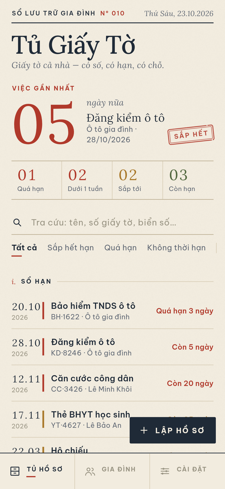<br>Trang chủ – Sắp đến hạn | 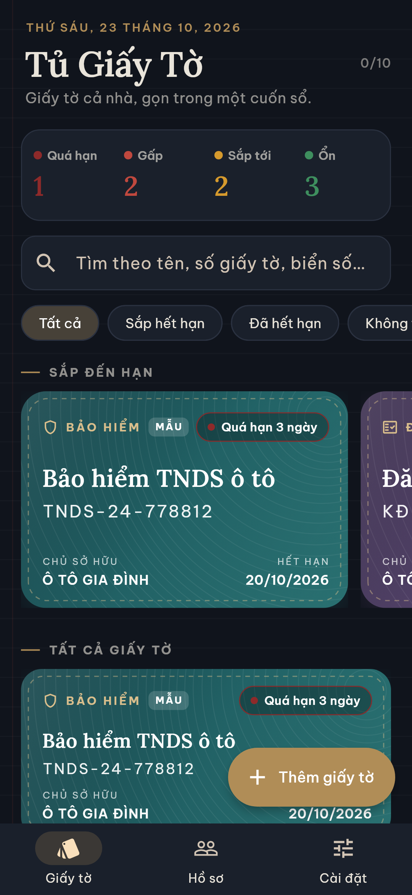<br>Chế độ tối | 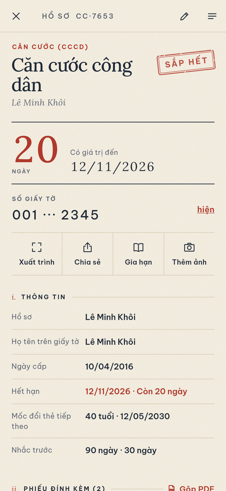<br>Chi tiết giấy tờ |
| 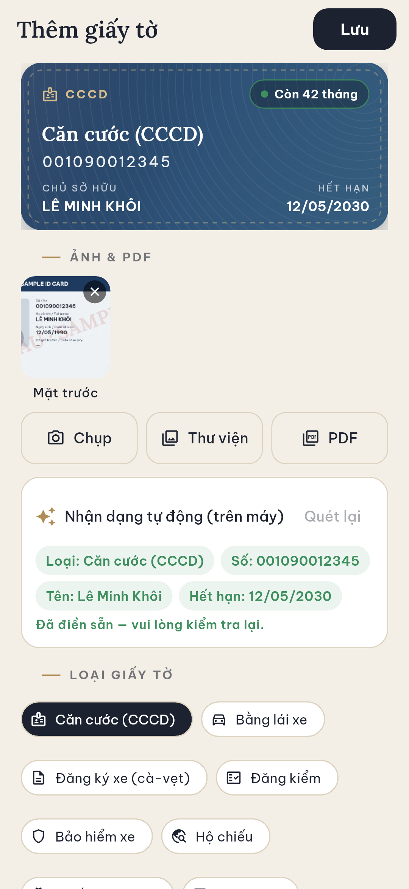<br>Thêm giấy tờ + nhận dạng | 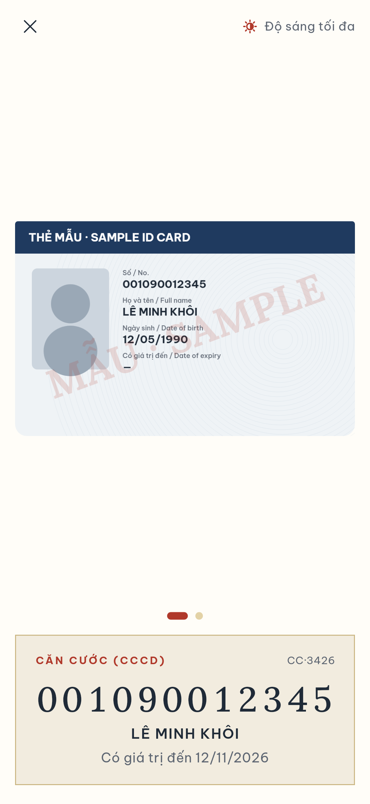<br>Xuất trình nhanh | 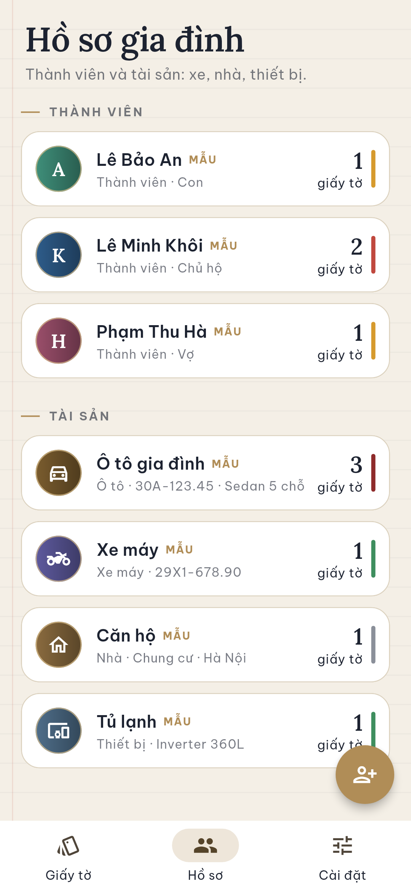<br>Hồ sơ gia đình |
| 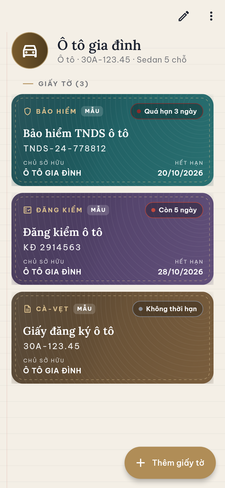<br>Hồ sơ tài sản (ô tô) | 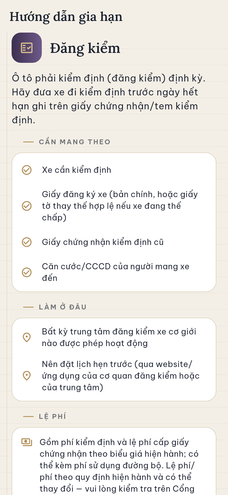<br>Hướng dẫn gia hạn | 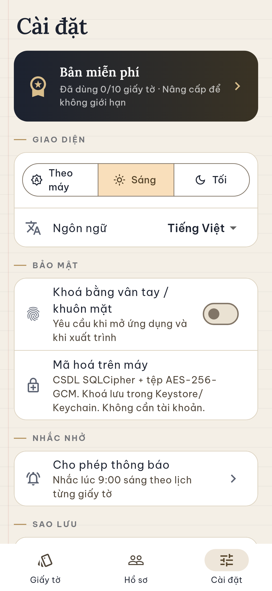<br>Cài đặt |
| 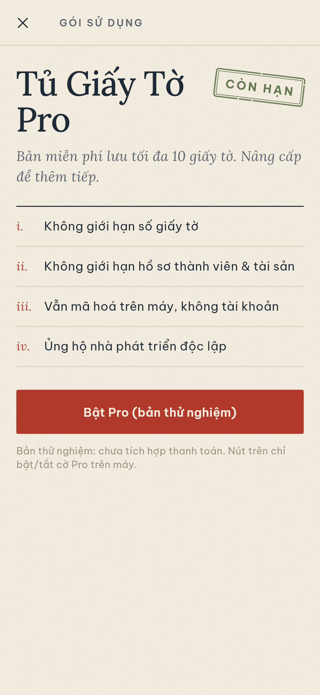<br>Pro (cờ thử nghiệm) | 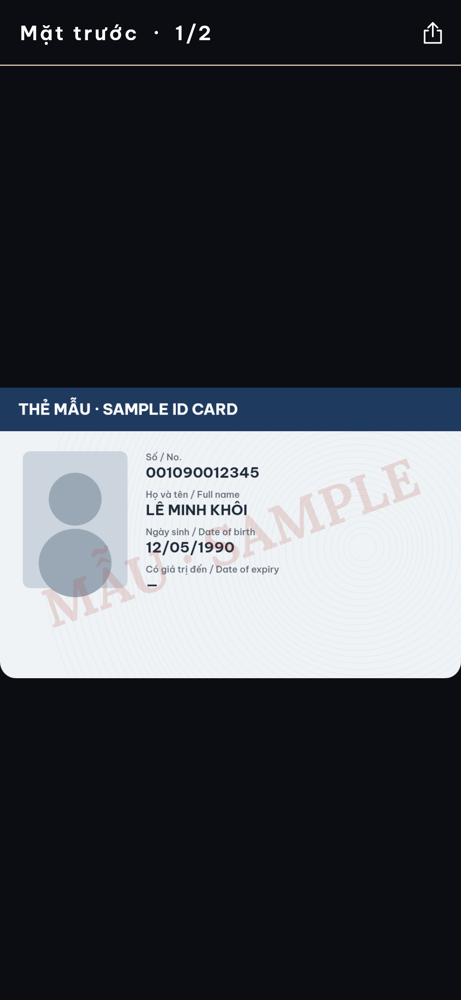<br>Trình xem ảnh/PDF | <br>Khoá sinh trắc học |
| 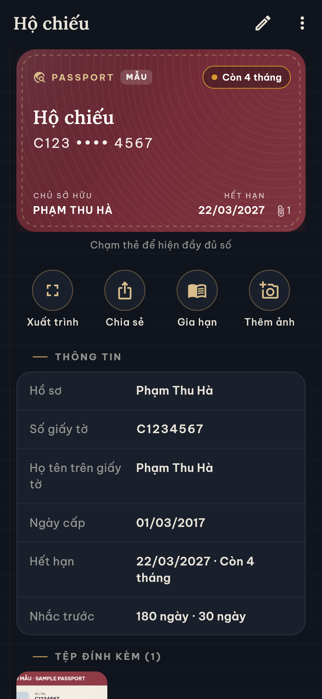<br>Hộ chiếu (tối) | 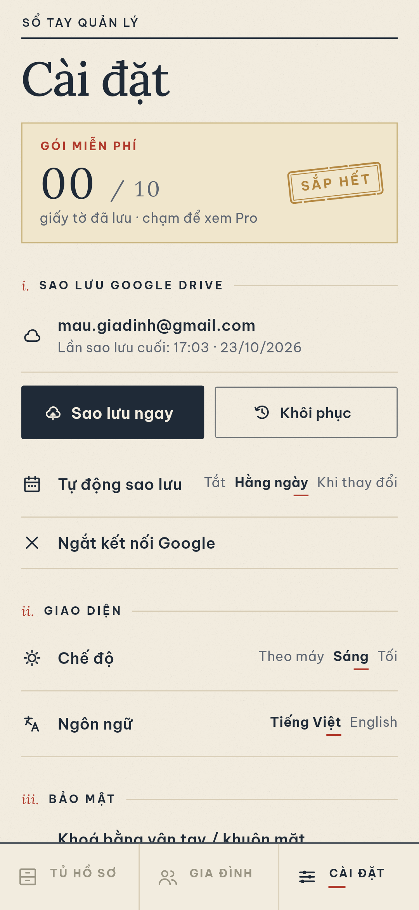<br>Sao lưu Google Drive | 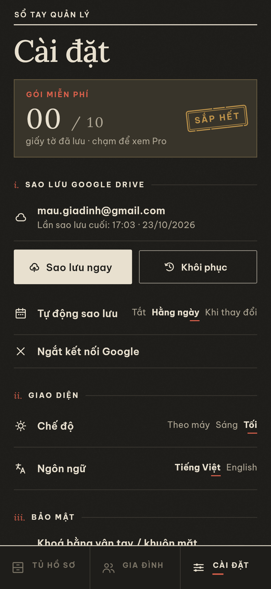<br>Drive (tối) |

## Tính năng

- **Thêm giấy tờ** bằng camera, ảnh trong thư viện hoặc file PDF. Mỗi giấy tờ có thể chứa nhiều tệp: mặt trước, mặt sau, các PDF.
- **Nhận PDF/ảnh chia sẻ từ ứng dụng khác**: Android hỗ trợ `ACTION_SEND`/`SEND_MULTIPLE`/`VIEW` cho PDF và ảnh.
- **Trình xem** ảnh (phóng to) và PDF nhiều trang. **Gộp nhiều ảnh thành 1 PDF** để chia sẻ.
- **OCR trên máy** (Google ML Kit Text Recognition) cho ảnh, và cho PDF bằng cách render trang thành ảnh rồi OCR. Ứng dụng tự nhận ra **CCCD, bằng lái, cà-vẹt, đăng kiểm, bảo hiểm xe, hộ chiếu (đọc MRZ), phiếu bảo hành, BHYT**, rồi điền sẵn số, họ tên và ngày hết hạn. Người dùng luôn xác nhận hoặc sửa trước khi lưu.
- **Hồ sơ** cho từng thành viên và tài sản (ô tô, xe máy, nhà, thiết bị).
- **Nhắc hạn bằng thông báo cục bộ**, có mốc mặc định theo loại: đăng kiểm, bảo hiểm và bảo hành nhắc trước 30/7 ngày; hộ chiếu trước 6 tháng (180/30 ngày); CCCD tự tính hạn theo **mốc tuổi 14 – 25 – 40 – 60** từ ngày sinh và ngày cấp. Mỗi giấy tờ có thể đặt thêm số ngày nhắc riêng.
- **Trang chủ "Sắp đến hạn"** xếp theo mức khẩn (xanh / vàng / đỏ), có tìm kiếm và lọc theo trạng thái, hồ sơ, loại.
- **Xuất trình nhanh**: toàn màn hình, độ sáng tối đa, hiện số lớn. Nếu bật khoá thì phải xác thực sinh trắc học trước.
- **Khoá ứng dụng** bằng vân tay/khuôn mặt (`local_auth`), tự khoá lại khi rời ứng dụng quá 30 giây.
- **Mã hoá cục bộ**: cơ sở dữ liệu SQLCipher, tệp đính kèm AES-256-GCM. Khoá chủ 256-bit ngẫu nhiên nằm trong Android Keystore / iOS Keychain (`flutter_secure_storage`). Ứng dụng không có tài khoản và không gửi dữ liệu lên mạng.
- **Sao lưu/khôi phục mã hoá**: file `.tgtbak` được bảo vệ bằng mật khẩu, khoá dẫn xuất bằng PBKDF2-HMAC-SHA256 (150.000 vòng) rồi mã hoá AES-256-GCM.
- **Hướng dẫn gia hạn** theo từng loại: cần mang gì, làm ở đâu, lệ phí, kèm liên kết tới [dichvucong.gov.vn](https://dichvucong.gov.vn). Nội dung chỉ mang tính tham khảo chung và **không ghi mức phí cụ thể**, chỉ nhắc người dùng kiểm tra lại.
- **Freemium**: bản miễn phí lưu tối đa 10 giấy tờ (dữ liệu mẫu không tính). Pro mở không giới hạn. Pro hiện **chỉ là cờ bật/tắt, chưa có thanh toán**.
- **Giao diện "sổ tay cao cấp"**: nền giấy kẻ dòng, chữ Lora + Be Vietnam Pro, thẻ "ví da" có đường chỉ khâu và hoa văn guilloche, chế độ tối.

## Sao lưu Google Drive (v0.2.0)

- Đăng nhập Google, chỉ xin quyền `drive.appdata`, tức thư mục ẩn riêng của ứng dụng. Ứng dụng không thấy file khác của bạn, và bạn cũng không thấy file này trong giao diện Drive.
- File tải lên chính là bản sao lưu `.tgt` **đã mã hoá** (AES-GCM, khoá dẫn xuất từ mật khẩu của bạn), nên Google không đọc được nội dung. Ứng dụng giữ 5 bản gần nhất.
- Có các nút **Sao lưu ngay** và **Khôi phục** (chọn bản trên Drive). Phần cài đặt hiển thị thời điểm sao lưu cuối.
- Sao lưu tự động có ba chế độ: Tắt, Hằng ngày, hoặc Khi thay đổi (chờ 15 phút sau lần sửa cuối). Chế độ này chạy bằng `workmanager` và chỉ chạy khi có mạng. Để chạy nền, ứng dụng cần lưu mật khẩu sao lưu trong Keystore/Keychain, và sẽ hỏi bạn đồng ý trước.
- Nếu bản build chưa có OAuth client, mục Drive hiện "Chưa bật trong bản build này". Các tính năng khác vẫn chạy bình thường. Từ v0.2.1, bản build mặc định dùng Web client của gooduselabs (khai báo trong `lib/config/google_config.dart`).

### Thiết lập Google Drive (cho người build)

1. Vào [Google Cloud Console](https://console.cloud.google.com/), tạo project (hoặc dùng project có sẵn), rồi bật **Google Drive API** trong *APIs & Services → Library*.
2. Vào *OAuth consent screen* và chọn loại *External*. Điền tên ứng dụng và email hỗ trợ, rồi thêm scope `https://www.googleapis.com/auth/drive.appdata`. Khi app còn ở trạng thái *Testing*, cần thêm email người thử vào *Test users*.
3. Vào *Credentials → Create credentials → OAuth client ID*, tạo các client sau:
   - **Android**: package `com.gooduselabs.tu_giay_to`, SHA-1 của keystore phát hành:
     ```
     SHA-1:   67:F8:86:FF:C4:27:E4:93:51:14:47:E8:BD:AB:67:33:E4:52:3F:40
     SHA-256: 7E:E2:58:C8:49:9D:52:F3:5A:84:01:0A:97:91:F1:AE:30:96:63:06:B0:10:9F:29:5A:E2:92:13:40:B1:82:BA
     ```
     Nếu dùng keystore khác (hoặc debug key), lấy SHA-1 bằng `keytool -list -v -keystore <file.jks> -alias <alias>`.
   - **Web application**: không cần redirect URI. *Client ID* của client này chính là `GOOGLE_SERVER_CLIENT_ID`, vì Android bắt buộc phải có nó.
   - **iOS** (tuỳ chọn): bundle ID `com.gooduselabs.tuGiayTo`. Client ID này là `GOOGLE_IOS_CLIENT_ID`. Sao chép `ios/Flutter/Google.xcconfig.example` thành `ios/Flutter/Google.xcconfig` rồi điền *reversed client ID* (URL scheme).
4. Repo đã có sẵn Web client mặc định trong `lib/config/google_config.dart`. Nếu dùng project riêng, ghi đè bằng tham số khi build:
   ```bash
   flutter build apk --release \
     --dart-define=GOOGLE_SERVER_CLIENT_ID=xxxx.apps.googleusercontent.com \
     --dart-define=GOOGLE_IOS_CLIENT_ID=yyyy.apps.googleusercontent.com
   ```

## Kiến trúc

```
lib/
  core/      models, OCR parser (thuần Dart), tính hạn/mốc CCCD, backup codec, hướng dẫn
  data/      AppStore (ChangeNotifier), SQLCipher + vault AES-GCM, dữ liệu mẫu
  services/  ML Kit OCR, thông báo, camera/file/PDF/chia sẻ, sinh trắc học, độ sáng
  ui/        theme, wallet card, các màn hình
  l10n/      tr() — chuỗi tiếng Việt là khoá, en.dart là bản dịch tiếng Anh
test/        logic_test.dart (OCR, mốc tuổi, backup, giới hạn), screenshots_test.dart (golden)
```

## Build

Yêu cầu: Flutter 3.47+ (stable), JDK 17+, Android SDK (compileSdk của Flutter), NDK do Flutter chỉ định.

```bash
flutter pub get
flutter test test/logic_test.dart           # kiểm thử logic
flutter test --update-goldens test/screenshots_test.dart   # tạo lại ảnh màn hình
flutter build apk --release                 # APK chung
flutter build apk --release --split-per-abi # APK nhỏ theo kiến trúc
```

**Ký bản phát hành (Android):** tạo `android/key.properties` (đã được gitignore, **không commit**):

```properties
storePassword=...
keyPassword=...
keyAlias=...
storeFile=/đường/dẫn/tới/keystore.jks
```

Nếu không có file này, bản release sẽ được ký bằng debug key.

**iOS:** project đã cấu hình sẵn quyền trong `Info.plist` (camera, thư viện ảnh, Face ID), mở PDF bằng "Open in", iOS tối thiểu 15.5 (ML Kit yêu cầu). Cần build trên macOS:

```bash
cd ios && pod install && cd ..
flutter build ios --release
```

## Giới hạn hiện tại

- Sao lưu Google Drive mới chỉ được kiểm tra bằng analyzer và golden test; chưa thử đăng nhập, tải lên/tải về hay chạy nền thật trên thiết bị. Trên iOS, tác vụ nền phụ thuộc vào lịch của hệ điều hành và có thể chạy trễ.

- Chưa build hay chạy thử iOS (dự án được phát triển trên Linux).
- iOS chưa có **Share Extension** nên chưa nhận PDF từ menu Chia sẻ. Muốn có, cần tạo target Share Extension trong Xcode theo hướng dẫn của `receive_sharing_intent`.
- OCR dùng bộ chữ Latin của ML Kit, nên dấu tiếng Việt có thể bị đọc sai. Bộ phân tích được thiết kế để chịu lỗi (bỏ dấu khi so khớp), nhưng người dùng luôn cần kiểm tra lại.
- Nhắc hạn dùng múi giờ Việt Nam cố định (Asia/Ho_Chi_Minh), báo lúc 9:00 sáng.
- Pro chỉ là cờ thử nghiệm, chưa tích hợp thanh toán.
- Hướng dẫn gia hạn hiện chỉ có tiếng Việt.

## Quyền riêng tư

Mọi dữ liệu nằm trên thiết bị của bạn, đã được mã hoá. Ứng dụng không có máy chủ riêng (Google Drive là tuỳ chọn và chỉ nhận file đã mã hoá), không theo dõi và không quảng cáo. `android:allowBackup="false"` để hệ điều hành không tự sao lưu dữ liệu ra ngoài; hãy dùng tính năng sao lưu có mật khẩu của ứng dụng.

---
© gooduselabs · Dữ liệu mẫu trong ảnh là hư cấu.
